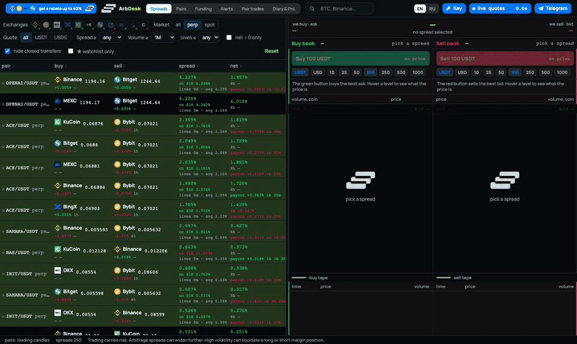
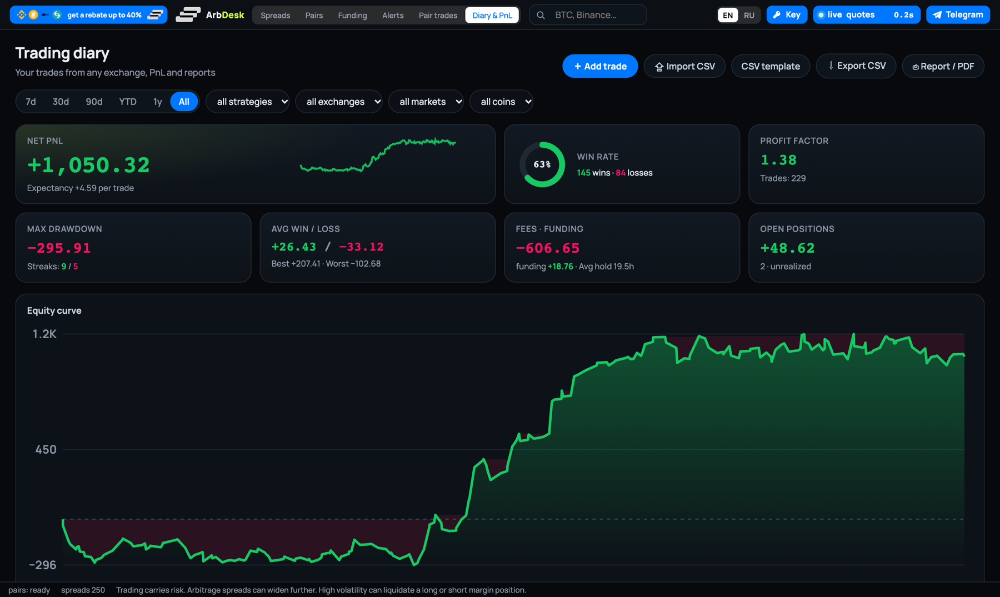
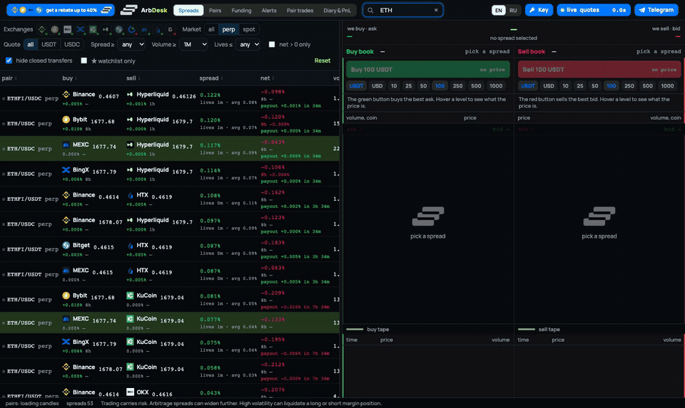
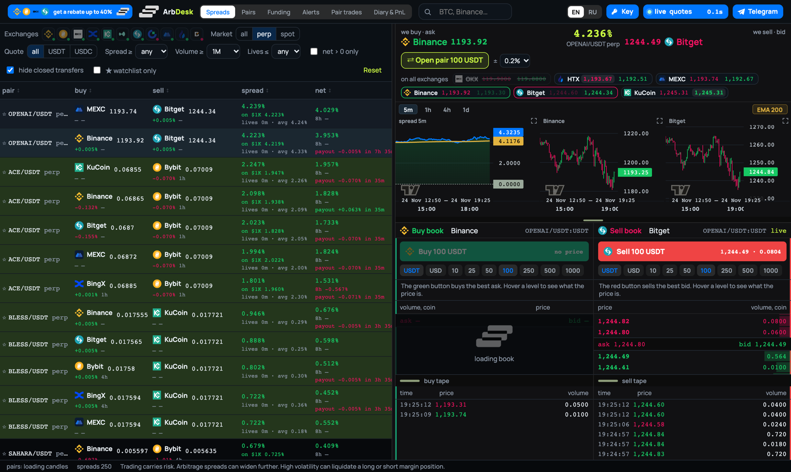
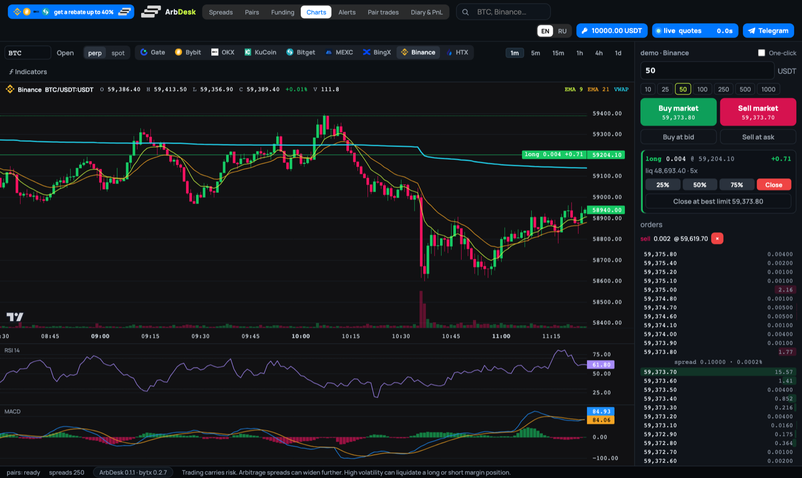
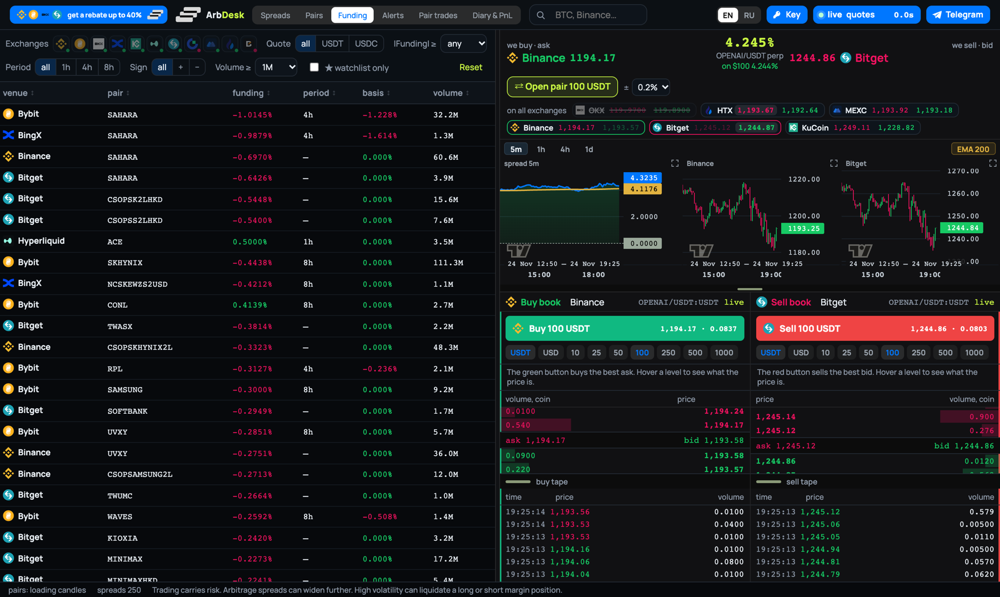
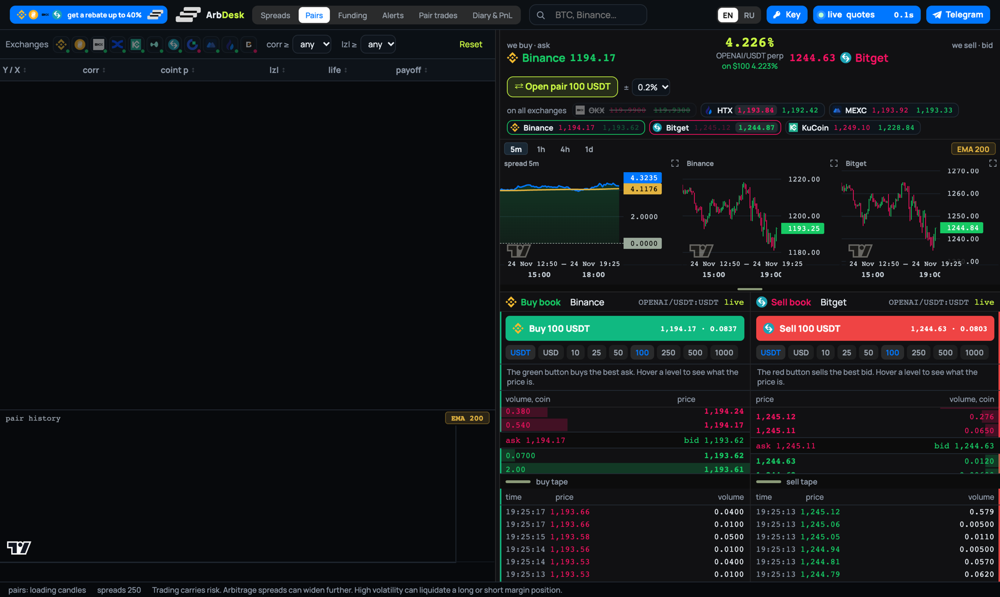
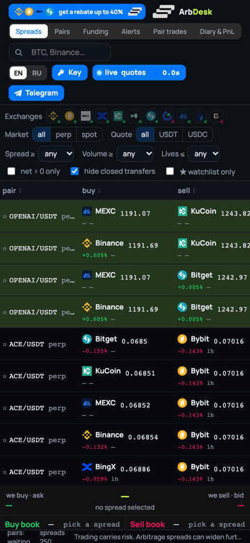

<p align="center">
  
</p>

<h1 align="center">ArbDesk — Free Crypto Arbitrage Terminal &amp; Trading Journal</h1>

<p align="center">
  <b>Find cross-exchange spreads, funding rate arbitrage and pair trades in real time on 11 crypto exchanges — and keep a trading diary with PnL, reports and infographics for all your trades.</b><br>
  Self-hosted · one Docker command · your keys never leave your machine
</p>

<p align="center">
  <a href="https://pypi.org/project/free-crypto-arbitrage-scanner/"></a>
  
  
  
  
  
  
  
</p>

<p align="center">
  &nbsp;
  &nbsp;
  &nbsp;
  &nbsp;
  &nbsp;
  &nbsp;
  &nbsp;
  &nbsp;
  &nbsp;
  &nbsp;
  
</p>

<p align="center">
  <a href="#-quick-start">Quick start</a> ·
  <a href="#-features">Features</a> ·
  <a href="#-trading-diary--pnl">Trading diary</a> ·
  <a href="#-screenshots">Screenshots</a> ·
  <a href="#-telegram-alerts">Telegram alerts</a> ·
  <a href="#-access-from-anywhere">Remote access</a> ·
  <a href="#-auto-update">Auto-update</a> ·
  <a href="#-security">Security</a> ·
  <a href="https://github.com/byttrade/free-crypto-arbitrage-scanner/blob/main/README.ru.md">Русский</a>
</p>

---

<p align="center">
  
</p>

## Why ArbDesk

Most arbitrage scanners show you a 12% "spread" that you can never take: the order book is empty, withdrawals are
closed, or fees eat everything. ArbDesk shows the **honest number**:

- 💸 **Net after fees.** Taker fees of *each* exchange, slippage reserve and the next funding payment are already subtracted.
- 📚 **Spread on your size.** It walks the real order book for $1,000 (configurable), not just best bid/ask.
- ⛔ **Withdrawal/deposit status.** Spot spreads where you cannot move the coin are flagged (and can be hidden).
- ⏱️ **Spread lifetime.** How long the spread has been open and its 1-hour average — fresh opportunity or a stuck quote.
- 🪪 **Same ticker, different coin.** Exchanges where the price is far from the rest are struck out.

## ⚡ Quick start

```bash
pip install free-crypto-arbitrage-scanner
arbdesk
```

The browser opens **http://127.0.0.1:8780** by itself — the first screen asks for a login and a password (or *Skip*
to use it without a password on this computer). Quotes appear in ~30 seconds, no API keys needed for scanning.
Python 3.11+.

<details>
<summary>Docker</summary>

```bash
git clone https://github.com/byttrade/free-crypto-arbitrage-scanner.git && cd free-crypto-arbitrage-scanner
docker compose up -d --build
```

Then open http://127.0.0.1:8780.
</details>

<details>
<summary>From source</summary>

```bash
npm install && npm run build:web
pip install .
arbdesk
```

UI development: `npm run dev:web` (Vite on :5173, API on :8780).
</details>

## ✨ Features

| | |
|---|---|
| 🔀 **Cross-exchange spreads** | Every USDT/USDC pair on 11 exchanges, spot and perpetual futures, 10,000+ markets. Sorting, search, filters by exchange, market, volume, spread, lifetime. |
| 🌐 **One coin on all exchanges** | Pick a spread and see the coin's bid/ask on every exchange at once — click any price to rebuild the pair. |
| 📈 **Funding rate arbitrage** | Funding rates, payout period and spot/perp basis on all perpetuals; the next payout is counted in the spread's net. |
| 🧮 **Pair trading** | Correlation and cointegration (ADF), z-score, half-life and historical win rate of mean reversion on 4h candles. |
| 📊 **L2 order books + tape** | Live WebSocket books and trades for both legs, side by side, with spread and price charts. |
| ⇄ **Open both legs in one click** | IOC orders on both exchanges with the same coin amount; size is capped by free balance and rounded to both lot steps. |
| 🩹 **Partial fill handling** | If one leg fills less — *Chase* the lagging leg or *Even out* the filled one. Nothing is sent without your click. |
| 📒 **Pair trades** | Every pair with entry spread, fills, imbalance, fees and live PnL; close with reduce-only orders; a leg closed by hand on the exchange is detected and the pair can be marked closed. |
| 🕯 **Charts for scalping** | Live candles of any coin on any exchange (1m–1d) built from the trade stream, with EMA, SMA, VWAP, Bollinger, volume, RSI and MACD; position, liquidation and order lines right on the chart. |
| ⚡ **Fast orders** | Market buy/sell, post-only at the best bid/ask, click a book level for a limit, close 25/50/75/100% or at the best limit. *One-click* mode with hotkeys B / S / H / X. |
| 📔 **Trading diary &amp; PnL** | All your trades — any exchange, any strategy, spot or futures: manual entry, CSV import, reports, equity curve and infographics. |
| ⭐ **Watchlist alerts** | Star a coin — get a Telegram and browser notification when its net spread crosses your threshold. |
| 🟢 **Exchange health** | A dot on every exchange: quote age, number of markets, last error. |
| 📱 **Works on a phone** | Responsive layout, EN / RU interface. |

## 📔 Trading diary & PnL

Not only spreads. Keep **all** your trades in one place — scalps, swings, trend, grid, funding — and see where the money comes from.

<p align="center"></p>

- ✍️ **Add trades by hand** — long/short, spot/perp/margin, fees, funding, leverage, strategy, tags and notes; PnL is calculated as you type. Open positions are marked to the live price.
- 📥 **Import past trades from CSV** — exports of Binance, Bybit, OKX and others are recognized by column names (EN/RU, `,` `;` or tab, decimal comma); duplicates are skipped. A template is one click away.
- 📊 **Infographics** — equity curve with drawdown, daily PnL calendar heatmap, PnL by month and weekday, by strategy, exchange, coin and market, win-rate ring, long vs short.
- 📈 **KPIs** — net PnL, win rate, profit factor, expectancy, max drawdown, avg win/loss, streaks, fees and funding, average holding time.
- 🖨 **Reports** — filter by period, strategy, exchange, market or coin, then *Report / PDF* prints a one-page dark report; *Export CSV* gives the raw data back.
- 🔗 Pair trades opened in the terminal appear in the diary automatically.

The diary is stored locally in `trades.json` on the `terminal-data` volume — nothing is sent anywhere.

<p align="center"></p>
<p align="center"><sub>Screenshots show sample data.</sub></p>

## 🖼 Screenshots

**Search a coin → see it on every exchange → order books of both legs**

<p align="center"></p>

**Spread, net after fees, spread on $1K, lifetime and next funding payout**

<p align="center"></p>

**Charts for scalping: candles, indicators, order book and one-click orders**

<p align="center"></p>

<table>
  <tr>
    <td width="50%"><b>Funding rates &amp; basis</b><br></td>
    <td width="50%"><b>Pair trading: cointegration &amp; z-score</b><br></td>
  </tr>
</table>

<p align="center"></p>

## 🔔 Telegram alerts

1. Create a bot with [@BotFather](https://t.me/BotFather) and copy the token.
2. In the panel: **Telegram** → paste the token → save.
3. Send `/start` to your bot — the chat id is filled in automatically.
4. **Test** checks delivery.

Default triggers (all configurable): spread ≥ **0.35%**, widening **+0.12% in 20 s**, funding ≥ **0.08%**,
watchlist net ≥ **0.1%**, 24h volume ≥ **$500k**, **180 s** cooldown per pair, global rate limit per minute.

## 🌍 Access from anywhere

Run ArbDesk on a home computer or a VPS and open it from your phone or laptop.

**Safest: keep the panel closed to the network and forward the port over SSH.** Leave the default mode on the server
(it listens on `127.0.0.1` only) and run on your own computer:

```bash
ssh -N -L 8780:127.0.0.1:8780 user@your-server
```

Then open http://127.0.0.1:8780 on your computer. Nothing is reachable from the internet and the traffic is encrypted
by SSH. Tailscale or WireGuard work the same way.

**Open to the network, with a login and a password:**

```bash
arbdesk --public
```

It listens on all addresses with HTTPS and prints a **one-time link**. Open it, enter a login, a password, repeat the
password — done. Until the account exists the panel gives nothing away, and the account can only be created through
that link.

With Docker:

```bash
ARBDESK_PUBLIC=1 ARBDESK_BIND=0.0.0.0 docker compose up -d --build
docker compose logs terminal          # the one-time link
```

- **HTTPS out of the box:** a certificate is generated on first start, the browser warns once (*Advanced → Proceed*).
  Have your own domain and proxy (nginx, Caddy, Cloudflare Tunnel)? Add `--http` (Docker: `ARBDESK_TLS=off`).
- **Sign-in** lasts 30 days per device; password guessing is slowed down after 5 wrong tries.
  Passwords are stored as scrypt hashes, never in clear text.
- **Forgot the password?** On the server: `arbdesk reset-password` (Docker:
  `docker compose exec terminal arbdesk reset-password`). It asks for a new password, signs out every device and
  works without a restart.

All options are available — local only, SSH tunnel or VPN, public with a password, behind your own proxy. You choose
the setup, and the risks of the chosen setup (open ports, weak passwords, server security) are entirely yours.

## 🔄 Auto-update

ArbDesk keeps itself and **[bytx](https://pypi.org/project/bytx/)** (the exchange SDK) up to date — on by default.
Exchanges change their APIs often; new bytx releases bring fixes, speed-ups and safer internals, and they reach you
without a manual upgrade.

- Once a day the PyPI index is checked. A new version inside the allowed range is installed, verified in a separate
  process (package files, imports, exchange objects) and the server restarts itself in place. Any failure — the
  previous version is put back.
- **Your trades are safe.** The update waits for a quiet minute (no order in flight, none in the last 2 minutes),
  pauses new orders while installing and lets in-flight orders finish. Nothing is closed or cancelled: positions,
  limit orders and pairs stay on the exchanges, the pair journal and the diary are on disk, and unlocked keys are
  handed to the new process, so you do not even re-enter the secret.
- The status, versions and an *Update now* button are in the footer. Set auto-update to *Notify* or *Off* there if
  you prefer to update by hand. Incompatible major versions are only announced, never installed.
- Orders go out only through the released bytx with its built-in broker attribution intact (bytx license, sections
  2(e) and 3(g)). If the installed bytx is modified, new orders are refused; cancelling orders and closing positions
  always stay available.

## 🔐 Security

- With a login and password the API and the socket open only after sign-in. Without one the panel accepts requests
  only from `127.0.0.1` / `localhost` (add hosts via `ALLOWED_HOSTS=host1,host2`).
  Requests and sockets from foreign sites are always rejected (403).
- Exchange API keys are stored **encrypted** and unlocked with your secret; demo/testnet keys are supported.
- Every action with a live key (except cancel) asks for confirmation. Opening a pair never retries an order blindly:
  on a timeout it looks the order up by client id.
- The Telegram token is never sent to the browser — only its last 4 characters.
- The container runs as a non-root user. Exchange blocked by your provider? Use `<EXCHANGE>_PROXY`, e.g. `BLOFIN_PROXY=http://host:port`.

<details>
<summary>Upgrading from an older version</summary>

If the `terminal-data` volume was created by an old version, run once:
`docker compose run --rm -u root terminal chown -R 10001 /data`
</details>

## 🧩 How it works

Exchange connectivity is built on **[bytx](https://pypi.org/project/bytx/)** — the BYTtrade exchange SDK
(the same one as in [free-crypto-trading-bot](https://github.com/byttrade/free-crypto-trading-bot)).
Order books, trades and best prices of visible pairs stream over WebSocket; the market-wide scan uses REST snapshots
every 1.5–3 s. Backend — FastAPI, frontend — React + Vite + lightweight-charts.

## ⚠️ Disclaimer

Not financial advice. Arbitrage spreads can widen further; transfers can be delayed; high volatility can liquidate
a leveraged position. Test with demo keys first.

<sub>Keywords: crypto arbitrage scanner, crypto arbitrage bot, cross-exchange arbitrage, funding rate arbitrage,
spot-futures arbitrage, perpetual futures spread, pair trading, crypto trading journal, trading diary, PnL tracker,
trade log, Binance Bybit OKX arbitrage, order book, open source, self-hosted.</sub>

---

<p align="center">Made by <a href="https://byttrade.com/?utm_source=github&utm_medium=free_tool&utm_campaign=free-crypto-arbitrage-scanner&utm_content=readme_en"><b>BYTtrade</b></a> · source-available, see <a href="https://github.com/byttrade/free-crypto-arbitrage-scanner/blob/main/LICENSE">LICENSE</a></p>
