<p align="center">
  
</p>

<h1 align="center">ArbDesk — бесплатный терминал криптоарбитража и дневник трейдера</h1>

<p align="center">
  <b>Межбиржевые спреды, арбитраж фандинга и парный трейдинг в реальном времени на 11 криптобиржах — и дневник трейдера с PnL, отчётами и инфографикой по всем вашим сделкам.</b><br>
  Запускается у вас · одна команда Docker · ключи не покидают ваш компьютер
</p>

<p align="center">
  
  
  
  
  
</p>

<p align="center">
  &nbsp;
  &nbsp;
  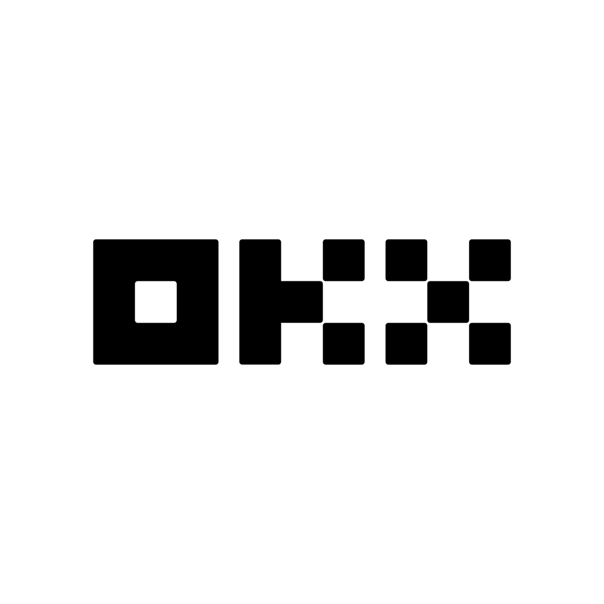&nbsp;
  &nbsp;
  &nbsp;
  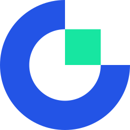&nbsp;
  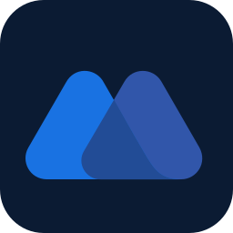&nbsp;
  &nbsp;
  &nbsp;
  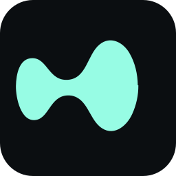&nbsp;
  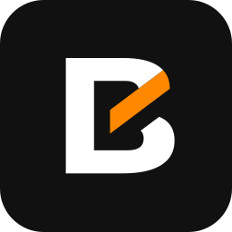
</p>

<p align="center">
  <a href="#-запуск">Запуск</a> ·
  <a href="#-возможности">Возможности</a> ·
  <a href="#-дневник-трейдера-и-pnl">Дневник</a> ·
  <a href="#-скриншоты">Скриншоты</a> ·
  <a href="#-алерты-в-telegram">Telegram</a> ·
  <a href="#-доступ-извне">Доступ извне</a> ·
  <a href="#-автообновление">Автообновление</a> ·
  <a href="#-безопасность">Безопасность</a> ·
  <a href="README.md">English</a>
</p>

---

<p align="center">
  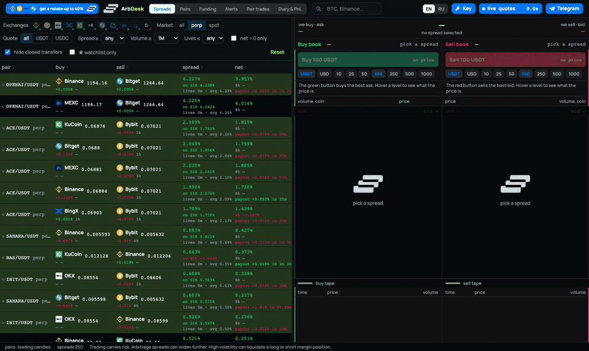
</p>

## Чем отличается

Обычный сканер показывает «спред 12%», который невозможно забрать: стакан пустой, вывод закрыт или всё съедают
комиссии. ArbDesk показывает **честную цифру**:

- 💸 **Net после комиссий.** Учтены taker-комиссии *каждой* биржи, запас на проскальзывание и ближайшая выплата фандинга.
- 📚 **Спред на ваш объём.** Расчёт идёт по реальному стакану на $1000 (настраивается), а не по лучшим ценам.
- ⛔ **Ввод и вывод.** Спотовые связки, где монету не перевести, помечены, их можно скрыть.
- ⏱️ **Время жизни спреда.** Сколько спред уже держится и средний за час: свежая возможность или зависшая котировка.
- 🪪 **Тот же тикер, другая монета.** Биржа, где цена далеко от остальных, перечёркнута.

## ⚡ Запуск

```bash
git clone <этот репозиторий> arbdesk && cd arbdesk
docker compose up -d --build
```

Откройте **http://127.0.0.1:8780** — первым экраном панель попросит логин и пароль (или *Пропустить* — тогда без
пароля и только на этом компьютере). Котировки появятся примерно через 30 секунд; для сканера ключи не нужны.

<details>
<summary>Без Docker</summary>

```bash
npm install && npm run build:web
pip install .
arbdesk            # сам откроет http://127.0.0.1:8780 в браузере
```

Разработка интерфейса: `npm run dev:web` (Vite на :5173, API на :8780).
</details>

## ✨ Возможности

| | |
|---|---|
| 🔀 **Межбиржевые спреды** | Все пары USDT/USDC на 11 биржах, спот и перпы, больше 10 000 рынков. Сортировка, поиск, фильтры по биржам, рынку, объёму, спреду, времени жизни. |
| 🌐 **Монета на всех биржах** | Выберите спред и увидьте bid/ask монеты на каждой бирже сразу. Клик по цене пересобирает связку. |
| 📈 **Арбитраж фандинга** | Ставки, период выплат и базис спот/перп по всем перпам; ближайшая выплата входит в net спреда. |
| 🧮 **Парный трейдинг** | Корреляция и коинтеграция (ADF), z-score, период полураспада и историческая доля отработки на 4h свечах. |
| 📊 **Стаканы L2 и лента** | Живые стаканы и сделки по WebSocket для обеих ног рядом, графики спреда и цен. |
| ⇄ **Связка в один клик** | IOC-ордера на обеих биржах на одинаковое число монет; объём режется по свободному балансу и шагу лота обеих бирж. |
| 🩹 **Частичное исполнение** | Если одна нога исполнилась меньше — «Догнать» отстающую или «Выровнять» исполненную. Без вашего клика ничего не отправляется. |
| 📒 **Связки** | Каждая связка: спред входа, исполнение, перекос, комиссии и живой PnL; закрытие reduce-only ордерами. |
| 📔 **Дневник и PnL** | Все ваши сделки — любая биржа, любая стратегия, спот или фьючерсы: ручной ввод, импорт CSV, отчёты, кривая капитала и инфографика. |
| ⭐ **Избранное и алерты** | Отметьте монету звёздочкой — уведомление в Telegram и браузер, когда её net превысит порог. |
| 🟢 **Здоровье бирж** | Точка у каждой биржи: возраст котировок, число рынков, последняя ошибка. |
| 📱 **С телефона** | Адаптивная вёрстка, интерфейс на русском и английском. |

## 📔 Дневник трейдера и PnL

Не только спред. Ведите **все** сделки в одном месте — скальпинг, свинг, тренд, сетка, фандинг — и смотрите, откуда приходят деньги.

<p align="center"></p>

- ✍️ **Ручной ввод** — лонг/шорт, спот/перп/маржа, комиссии, фандинг, плечо, стратегия, теги и заметка; PnL считается прямо при вводе. Открытые позиции оцениваются по живой цене.
- 📥 **Импорт прошлых сделок из CSV** — выгрузки Binance, Bybit, OKX и других узнаются по названиям колонок (RU/EN, `,` `;` или табуляция, десятичная запятая); дубли пропускаются. Шаблон — в один клик.
- 📊 **Инфографика** — кривая капитала с просадкой, календарь PnL по дням, PnL по месяцам и дням недели, по стратегиям, биржам, монетам и рынкам, кольцо win rate, лонг против шорта.
- 📈 **Показатели** — итоговый PnL, win rate, profit factor, матожидание, макс. просадка, средняя прибыль/убыток, серии, комиссии и фандинг, среднее время в сделке.
- 🖨 **Отчёты** — фильтр по периоду, стратегии, бирже, рынку или монете, затем *Отчёт / PDF* печатает отчёт в тёмной теме; *Экспорт CSV* отдаёт данные обратно.
- 🔗 Связки, открытые в терминале, попадают в дневник автоматически.

Дневник хранится локально в `trades.json` на томе `terminal-data` — никуда не отправляется.

<p align="center">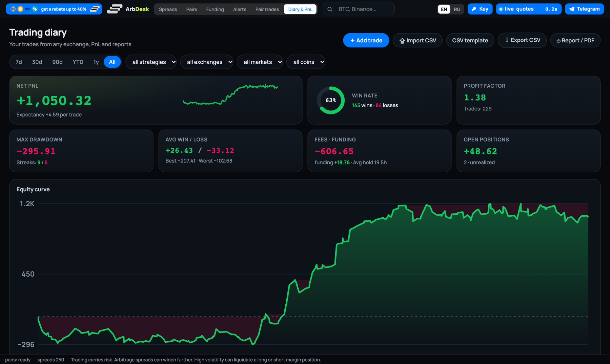</p>
<p align="center"><sub>На скриншотах пример данных.</sub></p>

## 🖼 Скриншоты

**Поиск монеты → цены на всех биржах → стаканы обеих ног**

<p align="center">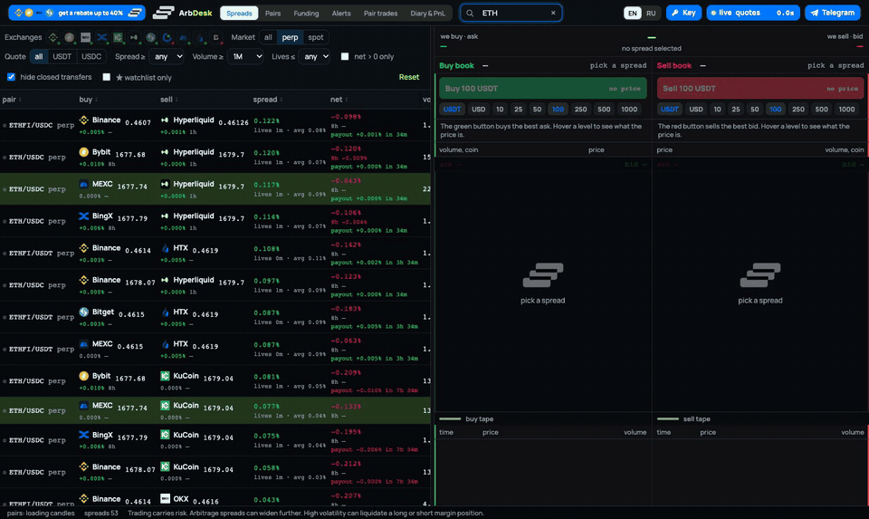</p>

**Спред, net после комиссий, спред на $1K, время жизни и ближайшая выплата фандинга**

<p align="center">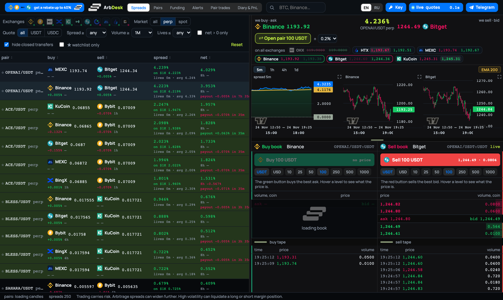</p>

<table>
  <tr>
    <td width="50%"><b>Фандинг и базис</b><br>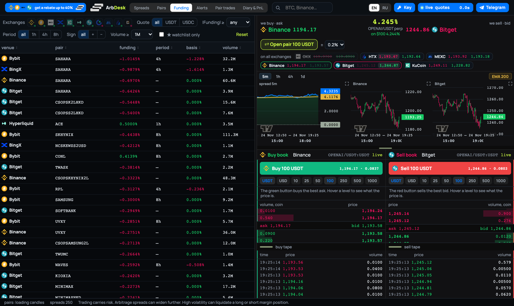</td>
    <td width="50%"><b>Пары: коинтеграция и z-score</b><br>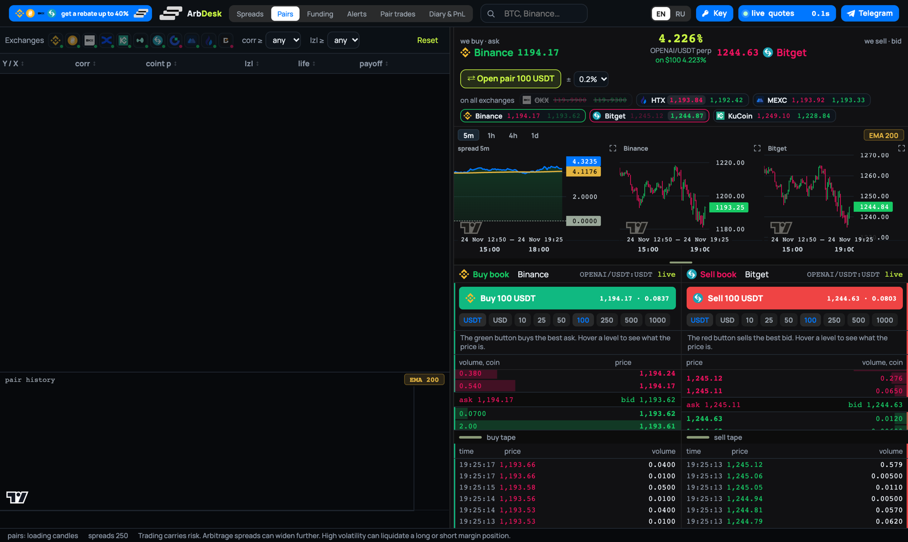</td>
  </tr>
</table>

<p align="center">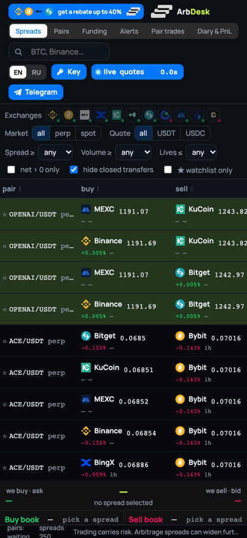</p>

## 🔔 Алерты в Telegram

1. Создайте бота у [@BotFather](https://t.me/BotFather), скопируйте токен.
2. В панели: **Telegram** → вставьте токен → сохраните.
3. Напишите боту `/start` — chat id подставится сам.
4. Кнопка **Тест** проверяет доставку.

Пороги по умолчанию (меняются в настройках): спред от **0,35%**, расширение **+0,12% за 20 с**, фандинг от **0,08%**,
net избранного от **0,1%**, объём за 24ч от **$500k**, антиспам **180 с** на связку и общий лимит сообщений в минуту.

## 🌍 Доступ извне

Запустите ArbDesk на домашнем компьютере или VPS и открывайте с телефона или ноутбука — по логину и паролю.

```bash
arbdesk --public
```

Панель слушает все адреса по HTTPS и печатает **одноразовую ссылку**. Откройте её, введите логин, пароль, повторите
пароль — готово. Пока учётной записи нет, панель ничего не отдаёт наружу, а создать её можно только по этой ссылке.

В Docker:

```bash
ARBDESK_PUBLIC=1 ARBDESK_BIND=0.0.0.0 docker compose up -d --build
docker compose logs terminal          # одноразовая ссылка
```

- **HTTPS сразу:** сертификат создаётся при первом запуске, браузер один раз предупредит (*Дополнительно → Перейти*).
  Есть свой домен и прокси (nginx, Caddy, Cloudflare Tunnel)? Добавьте `--http` (Docker: `ARBDESK_TLS=off`).
- **Вход** держится 30 дней на устройстве; после 5 неверных попыток подбор пароля замедляется.
  Пароль хранится как хеш scrypt, в открытом виде — нигде.
- **Забыли пароль?** На сервере: `arbdesk reset-password` (Docker:
  `docker compose exec terminal arbdesk reset-password`). Спросит новый пароль, выйдет со всех устройств, перезапуск
  не нужен.
- Не хотите открывать порт вовсе? Оставьте обычный режим и заходите через Tailscale или SSH-туннель.

## 🔄 Автообновление

ArbDesk сам обновляет себя и **[bytx](https://pypi.org/project/bytx/)** (SDK бирж) — по умолчанию включено.
Биржи часто меняют API; новые версии bytx приносят исправления, ускорения и более надёжное устройство, и всё это
доходит до вас без ручного обновления.

- Раз в сутки проверяется PyPI. Новая версия из допустимого диапазона ставится, проверяется в отдельном процессе
  (файлы пакета, импорты, объекты бирж), и сервер перезапускается на месте. Любой сбой — возвращается прежняя версия.
- **Сделки в безопасности.** Обновление ждёт тихую минуту (нет ордера в полёте и не было ордеров 2 минуты), на время
  установки приостанавливает новые ордера и даёт отправленным дойти до конца. Ничего не закрывается и не отменяется:
  позиции, лимитки и связки остаются на биржах, журнал связок и дневник лежат на диске, а открытые ключи передаются
  новому процессу — секрет вводить заново не нужно.
- Статус, версии и кнопка *Обновить* — в подвале панели. Там же автообновление можно перевести в *Сообщать* или
  *Выкл*. Несовместимые major-версии только показываются и сами не ставятся.
- Ордера уходят только через выпущенный bytx с его встроенной брокерской атрибуцией (лицензия bytx, пп. 2(e) и 3(g)).
  Если установленный bytx изменён, новые ордера не отправляются; отмена ордеров и закрытие позиций доступны всегда.

## 🔐 Безопасность

- С логином и паролем API и сокет открываются только после входа. Без них панель принимает запросы только
  с `127.0.0.1` / `localhost` (другие адреса — `ALLOWED_HOSTS=host1,host2`).
  Запросы и сокет с чужих сайтов отклоняются всегда (403).
- API-ключи бирж хранятся **зашифрованными** и открываются вашим секретом; поддерживаются demo/testnet-ключи.
- Каждое действие с live-ключом, кроме отмены, требует подтверждения. При таймауте ордер не отправляется повторно —
  он ищется по client id.
- Токен бота в браузер не отдаётся, видны только последние 4 символа.
- Контейнер работает не от root. Биржа недоступна у провайдера — прокси через `<EXCHANGE>_PROXY`,
  например `BLOFIN_PROXY=http://host:port`.

<details>
<summary>Обновление со старой версии</summary>

Если том `terminal-data` создан старой версией, один раз выполните:
`docker compose run --rm -u root terminal chown -R 10001 /data`
</details>

## 🧩 Как устроено

Подключение к биржам — через **[bytx](https://pypi.org/project/bytx/)**, SDK бирж от BYTtrade
(тот же, что в [free-crypto-trading-bot](https://github.com/byttrade/free-crypto-trading-bot)).
Стаканы, сделки и лучшие цены видимых пар идут по WebSocket; общий скан рынка — REST-снимки раз в 1,5–3 с.
Сервер — FastAPI, интерфейс — React + Vite + lightweight-charts.

## ⚠️ Риски

Не финансовый совет. Спред может расшириться дальше, перевод может задержаться, высокая волатильность может
ликвидировать позицию с плечом. Начните с demo-ключей.

<sub>Ключевые слова: сканер криптоарбитража, арбитраж криптовалют, межбиржевой арбитраж, арбитраж фандинга,
спот-фьючерсный арбитраж, спред перпетуалов, парный трейдинг, дневник трейдера, журнал сделок, учёт PnL,
арбитраж Binance Bybit OKX, стакан, open source, self-hosted.</sub>

---

<p align="center">Сделано в <b>BYTtrade</b> · source-available, см. <a href="LICENSE">LICENSE</a></p>
